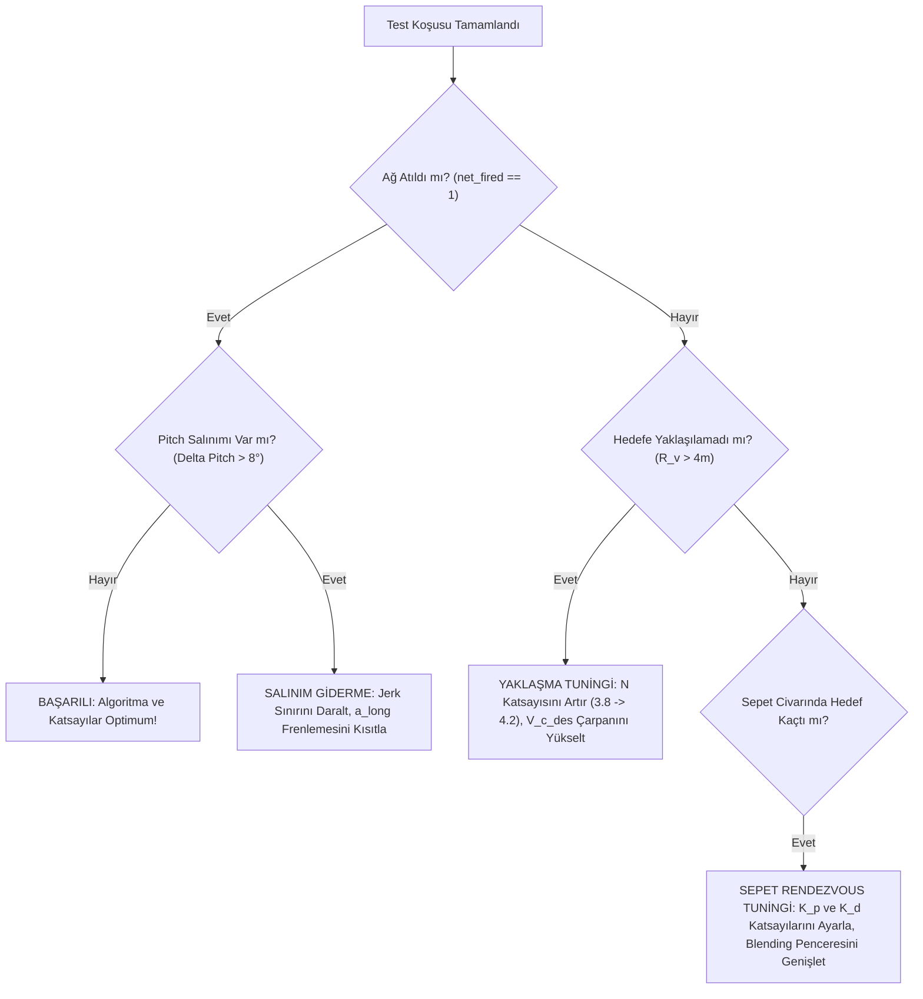

# Otonom Önleme Koşu Testleri, Telemetri Analizi ve Güdüm Tuning Kılavuzu (kosu_test.md)

Bu doküman; **Ukrayna Octopus / Vakkas VTOL Tailsitter Önleyici Dronun**, kaçınma manevraları yapan **Talon-1718 hedef İHA'sına** karşı gerçekleştireceği simülasyon koşularını, yüksek frekanslı telemetri loglama sistemini, uçuş verisi analiz yöntemlerini ve **APN (Augmented Proportional Navigation)** ile **IBVS (Image-Based Visual Servoing)** güdüm algoritmalarının tuning / revizyon kurallarını tanımlar.

> [!NOTE]
> Bu doküman hem insan mühendisler hem de yapay zeka ajanları (AI Coding / Flight Test Agents) tarafından doğrudan okunup uçtan uca otomatik test koşuları koşturulabilecek şekilde hazırlanmıştır.

---

## 1. Test Mimarisi ve Simülasyon Altyapısı

Önleme simülasyonu, donanım ve yazılım katmanlarını aşağıdaki bileşenlerle koşturur:
- **PX4 Autopilot (SITL):** Önleyici dronun uçuş kontrolcüsü (`bin/px4`), navigasyon, durum kestirimi ve `src/modules/intercept` otonom önleme modülü.
- **Gazebo Harmonic (GZ):** Fiziksel dünya, aerodinamik kuvvetler, Storm32 3-eksenli gimbal, burun kamerası (`nose_camera`) ve MITLA 2.0 ağ fırlatıcı canister'ı (`net_launcher`).
- **target_sim.py:** Talon-1718 kinematik hedef motoru. Dinamik manevra rotaları (weave, square, break turn, climb/dive) üretir, PX4'e ADS-B ve HTTP üzerinden durum yayınlar.
- **sim_detector.py & view_hud.py:** Gerçek zamanlı optik hedef tespit simülatörü ve HUD video arayüzü (50/80 FPS dinamik kamera modeli, 3D STL mesh projeksiyonu).
- **ground_relay.py:** Yer istasyonu hedef takip rölesi (MAVLink `FOLLOW_TARGET`).
- **Telemetry Recorder:** 50 Hz çok kanallı senkronize telemetri kayıtçısı (`CSV` ve `JSONL` çıktıları).

---

## 2. Hedef (Talon-1718) Manevra Tipleri ve Koşu Matrisi

Güdüm algoritmasını sağlamlaştırmak için Talon hedefine aşağıdaki 6 standart manevra profili koşturulmalıdır:

| Koşu ID | Manevra Adı | Profil Açıklaması | Test Edilen Güdüm Kabiliyeti | Başarı Kriteri |
| :--- | :--- | :--- | :--- | :--- |
| **RUN-01** | **Baseline Straight** | 22 m/s düz ve yatay uçuş, irtifa 60m. | Uzak fazdan yaklaşma, sanal sepete oturma ve ağ atım zarfı. | Hedefin 2.5m arkasına oturma ($R_v \le 2.2m$), Ağ Atışı |
| **RUN-02** | **Sinusoidal Weave (S-Dönüşü)** | $\pm 30^\circ$ bank açısı, frekans: 0.3 Hz, genlik: 35 m, hız: 22 m/s. | Görüş hattı açısal hızı ($\dot{\lambda}$) takibi, yanal APN tepkisi ve kuyruk sallama (fishtailing) sönümleme. | Yanal sapma $< 1.5m$, LOS hız doyumsuz takip |
| **RUN-03** | **High-G Break Turn** | $40^\circ - 45^\circ$ sert ani bank dönüşü, hız: 26 m/s. | Gimbal açısal hız limiti (90°/s), kamera FOV sınırında hedefi tutma, hedef merkezkaç ivmesi telafisi. | Görüş hattı kaybı (Loss of Lock) yaşanmaması |
| **RUN-04** | **Vertical Jink (Dalış & Tırmanış)** | 25m ani dikey dalış, ardından 30m dik tırmanış ($V_z \approx \pm 6$ m/s). | Önleyici dronun tilt/pitch açısı ile irtifa kontrolü ayrışması; dikey eksen APN katsayısı. | İrtifa hatası $< 2.0m$, aşırı dalış/çakılma olmaması |
| **RUN-05** | **Speed Jink (Hız Değişimi)** | 14 m/s'den aniden 28 m/s'ye ivmelenme ve ardından motor kesme. | Kapanma hızı ($V_c$) regülasyonu, aşırı boyuna frenleme klamplaması (pitch flip önleme). | Geriye takla atmama, $V_c \in [1, 4]$ m/s yakalama |
| **RUN-06** | **Compound 3D Evasion** | Spiral dalış + S-dönüşü + ani tırmanış kombinasyonu (Tam kaçış). | Karmaşık 3D yörünge takip stabilitesi, Blended APN ve IBVS nihai performans testi. | Hedef sepetine $< 3.0m$ yaklaşma, ağ atımı |

---

## 3. Koşuların Çalıştırılma Prosedürü

### 3.1. Manuel / Görsel Koşu Başlatma (Geliştirici İncelemesi İçin)
Gazebo GUI ve HUD kamera penceresiyle birlikte çalıştırmak için:
```bash
cd /home/kayra/Masaüstü/vakkas/PX4-Autopilot

# Standart Düz Uçuş
./Tools/simulation/interceptor_sim/sim.sh

# Belirli bir manevra tipiyle çalıştırma (örn: S-dönüşü kaçınma)
PATTERN=weave SPEED=24 ALT=70 ./Tools/simulation/interceptor_sim/sim.sh
```

### 3.2. Otomatik Başlatma, Telemetri Kaydı ve Değerlendirme (AI / Otomasyon İçin)
Herhangi bir GUI açmadan, tam senkronize 50 Hz telemetri kaydederek manevra değerlendirmesi yapmak için:
```bash
cd /home/kayra/Masaüstü/vakkas/PX4-Autopilot

# Tam otomatik 5-Aşamalı Manevra Değerlendirme Koşusu (0 - 90s)
python3 Tools/simulation/interceptor_sim/tools/run_maneuver_evaluation.py \
    --duration 90 \
    --target-speed 22.0 \
    --target-alt 60.0

# 3D Blended APN + Ağ Atma Yakalama Koşusu
python3 Tools/simulation/interceptor_sim/tools/test_apn_rendezvous.py
```

### 3.3. Koşu Sırasında Dinamik Manevra Enjeksiyonu (HTTP REST API)
Koşu devam ederken hedef uçağa dışarıdan anlık kaçış komutu yollamak için `target_sim` HTTP arayüzü kullanılır:
```bash
# 1. Weave (S-Dönüşü) moduna geçir:
curl -X POST http://localhost:8000/cmd -H "Content-Type: application/json" \
     -d '{"mode": "weave", "speed": 24.0, "alt": 60.0}'

# 2. Sert Dönüş (High-G Turn) yaptır:
curl -X POST http://localhost:8000/cmd -H "Content-Type: application/json" \
     -d '{"mode": "circle", "turn_rate": 0.4, "speed": 26.0}'

# 3. Ani Dikey Dalış (Dive):
curl -X POST http://localhost:8000/cmd -H "Content-Type: application/json" \
     -d '{"mode": "dive", "alt": 35.0, "speed": 25.0}'
```

---

## 4. Loglanması Zorunlu Veriler (50 Hz Telemetri Veri Sözlüğü)

Otomasyon koşturulduğunda `Tools/simulation/interceptor_sim/build/telemetry/` klasörüne `YYYYMMDD_HHMMSS_flight_telemetry.csv` dosyası yazılır. Aşağıdaki sinyaller eksiksiz bulunmalıdır:

### A. Zaman ve Kinematik Durumlar (World / NED Çerçevesi)
- `t_sim`: Simülasyon zamanı [saniye].
- `int_pos_x`, `int_pos_y`, `int_pos_z`: Önleyici Dron pozisyonu (NED) [m].
- `int_vel_x`, `int_vel_y`, `int_vel_z`: Önleyici Dron hız vektörü (NED) [m/s].
- `int_acc_x`, `int_acc_y`, `int_acc_z`: Önleyici Dron ivmesi (NED) [m/s²].
- `int_roll`, `int_pitch`, `int_yaw`: Önleyici Dron yönelim açıları (Euler ZYX) [derece].
- `int_tilt`: Dikey eksenden gövde sapma (tilt) açısı [derece] ($= \arccos(R_{33})$).

### B. Hedef Kinematiği (Talon 1718)
- `tgt_pos_x`, `tgt_pos_y`, `tgt_pos_z`: Hedef pozisyonu (NED) [m].
- `tgt_vel_x`, `tgt_vel_y`, `tgt_vel_z`: Hedef hız vektörü (NED) [m/s].
- `tgt_acc_x`, `tgt_acc_y`, `tgt_acc_z`: Hedef ivme vektörü (NED) [m/s²].
- `tgt_roll`, `tgt_pitch`, `tgt_yaw`: Hedef oryantasyonu [derece].

### C. Bağıl Geometri ve Güdüm Büyüklükleri
- `R_target`: Hedef ile önleyici arasındaki mesafe ($|\mathbf{r}_t|$) [m].
- `R_basket`: Sanal sepet noktası mesafesi ($R_v = |\mathbf{p}_v - \mathbf{p}_{int}|$) [m].
- `V_closing`: Kapanma hızı ($V_c = -\dot{R}$) [m/s].
- `los_azimuth`, `los_elevation`: Görüş hattı açıları [derece].
- `los_rate_az`, `los_rate_el`: Görüş hattı açısal hızları ($\dot{\lambda}_{az}, \dot{\lambda}_{el}$) [deg/s].

### D. Güdüm Komutları ve Aktüatör Durumları
- `cmd_acc_x`, `cmd_acc_y`, `cmd_acc_z`: Güdüm modülünden PX4'e iletilen ivme komutu [m/s²].
- `cmd_yaw`: Burun hedefleme komutu [derece].
- `gmb_cmd_yaw`, `gmb_cmd_pitch`: Seeker gimbal açı komutları [derece].
- `gmb_act_pitch`: Gimbal gerçek pitch link açısı (Gazebo link encoder) [derece].
- `barrel_cmd_pitch`: MITLA 2.0 namlu açı komutu [derece].

### E. Optik & Kamera Durumu (IBVS & Detector)
- `vis_detected`: Görsel temas var mı (0 veya 1).
- `vis_cx`, `vis_cy`: Hedef merkezinin görüntüdeki piksel koordinatı (normalize [0, 1]).
- `vis_w`, `vis_h`: Bounding Box genişlik ve yüksekliği (normalize [0, 1]).
- `vis_area`: Bounding box piksel alanı ($w \times h$).

### F. Karar Mekanizması ve Durum Bayrakları
- `guidance_phase`: 0: STANDBY, 1: APN_CRUISE, 2: BLENDING, 3: RENDEZVOUS, 4: NET_FIRED.
- `target_source`: GPS_FOLLOW_TARGET, VISION, DEAD_RECKONING.
- `envelope_counter`: Ateşleme penceresi doğrulama sayacı (0 ile 8 arası).
- `net_fired`: Ağ fırlatıldı mı (0 veya 1).

---

## 5. Uçuş Verisi Analiz Metodolojisi (Ne Analiz Edilmeli?)

Her uçuştan sonra elde edilen CSV logu otomatik bir analiz fonksiyonundan geçirilir. Analiz aşağıdaki 5 kritik soruya cevap vermelidir:

### Metrik 1: En Yakın Geçirme Mesafesi (Miss Distance) & Sepet Takip Hatası ($R_v$)
- Hedefin 2.5m arkasındaki sanal sepet ile önleyici arasındaki minimum mesafe nedir?
- **Hedef:** Minimum $R_v \le 1.8$ metre olmalıdır.
- $R_v > 3.0$ metre ise güdüm yaklaşma fazında hedefi yakalayamamıştır.

### Metrik 2: Dron Gövdesi Tilt/Pitch Salınımı (Limit Cycle Tespiti)
- İleri uçuşta dron burun aşağı yatarken ($\text{Pitch} \approx -15^\circ \dots -25^\circ$) salınım yapıyor mu?
- **Analiz:** Uçuşun cruise/pursuit bölümünde `int_pitch` verisinin tepe-tepe genliği ($\Delta \theta_{pp}$) ve FFT spektrumu hesaplanır.
- **Kriter:**
  - $\Delta \theta_{pp} \le 5^\circ$ $\rightarrow$ **Mükemmel stabilite.**
  - $5^\circ < \Delta \theta_{pp} \le 10^\circ$ $\rightarrow$ **Kabul edilebilir hafif salınım.**
  - $\Delta \theta_{pp} > 10^\circ$ veya $0.5 - 1.5$ Hz baskın frekans $\rightarrow$ **Rezonans / Limit Cycle (Güdüm ivmesi ve uçuş kontrolcüsü çakışıyor!).**

### Metrik 3: Gimbal Kilitlenme Hassasiyeti ve Kamera Görüş Kaybı (Loss of Lock)
- Hedef kamera çerçevesinin merkezinde ne kadar iyi tutuldu?
- **Analiz:** Hedef merkez hatası $e_{px} = \sqrt{(c_x - 0.5)^2 + (c_y - 0.5)^2}$.
- **Kriter:**
  - $e_{px} < 0.15$ (Hedef görüş alanı merkez bölgesinde).
  - Eğer $vis\_detected = 0$ süresi toplam takip süresinin $\%5$'inden fazlaysa $\rightarrow$ Gimbal slew rate yetersiz veya kazançlar düşük.

### Metrik 4: Kapanma Dinamiği ve Geriye Takla (Pitch Flip) Kontrolü
- Hedefe arkadan yaklaşırken önleyici aşırı sert frenleme yapıp geriye dikildi mi?
- **Analiz:** $\mathbf{a}_{cmd} \cdot \mathbf{u}_t$ (hedef gidiş yönündeki ivme bileşeni) negatif yönde ne kadar büyüyor?
- **Kriter:** Boyuna yavaşlama $-4.5 \text{ m/s}^2$'den daha sert olmamalıdır. Dronun ani olarak burun kaldırması ($d(\text{Pitch})/dt > 40^\circ/\text{s}$) engellenmelidir.

### Metrik 5: Ağ Atma Zarfı ve Yakalama Başarısı
- Dron aşağıdaki 3 koşulu **art arda en az 8 kontrol çevrimi (yaklaşık 0.15 saniye)** sağladı mı?
  1. Sepet mesafesi $R_v \le 2.2$ metre.
  2. Bağıl hız $|\mathbf{v}_{int} - \mathbf{v}_{tgt}| \le 2.5$ m/s.
  3. Yönelim paralelliği $\mathbf{u}_{fwd} \cdot \mathbf{u}_{tgt} \ge 0.95$ ($< 18^\circ$ açı farkı).
- Sonuç: `net_fired == 1` olduysa test **BAŞARILI (CAPTURE CONFIRMED)** sayılır.

---

## 6. Güdüm Algoritmasını İyileştirme ve Parametre Tuning Karar Matrisi

Elde edilen analiz verisine göre uygulanacak tuning adımları:



### Detaylı Parametre Değişiklik Tablosu:

| Gözlenen Problem | Olası Kök Neden | Değiştirilecek Parametre / Dosya | Tavsiye Edilen Düzeltme |
| :--- | :--- | :--- | :--- |
| **Hedef S-dönüşü yaparken önleyici viraj dışına savruluyor** | Yanal yönlendirme yetersiz, APN katsayısı düşük | `INT_APN_N` (`src/modules/intercept/module.yaml`) | `INT_APN_N` değerini `3.8`'den `4.2` veya `4.5`'e yükseltin. |
| **Hedefe 10m kala araç burnunu yukarı dikip takla atmaya çalışıyor** | Yaklaşırken hız farkını sıfırlamak için aşırı negatif boyuna ivme isteniyor | `Intercept.cpp` (`a_long_clamped`) | `a_long_clamped = math::max(a_long, -3.5f)` (Frenlemeyi -4.5'ten -3.5 m/s² seviyesine kısıtlayın). |
| **Araç ileri uçarken sürekli aşağı-yukarı tilt/pitch dalgalanması yapıyor** | İvme jerk limiti çok yüksek veya APN ivmesi ile pitch kontrolcüsü rezonansta | `max_jerk` (`Intercept.cpp`) veya `MC_PITCH_P` | `max_jerk` değerini `70.0f`'den `45.0f` seviyesine indirin; `INT_ACC_MAX` değerini `55.0`'dan `45.0`'a çekin. |
| **Sepete yaklaşıyor ama tam 2.5m arkasında kalamayıp sağa-sola taşıyor** | Yakın faz Rendezvous PID oransal kazancı zayıf veya integral rüzgarı | `Intercept.cpp` (`a_cmd_rendezvous`) | Konum kazancını `6.5f` yerine `8.0f`, türev kazancını `4.2f` yerine `5.2f` yapın; integral sınırını `[-3, 3]` yapın. |
| **Sert virajda kamera hedefi kaybediyor ($vis\_detected = 0$)** | Seeker gimbal açısal hızı yetişemiyor veya P kazancı düşük | `interceptor.yaml` (`gimbal.p_gain`) | Gimbal P kazancını `8.0`'dan `12.0`'a yükseltin, `max_rate_deg_s` değerini `120` yapın. |

---

## 7. IBVS (Image-Based Visual Servoing) Güdüm Entegrasyonu

Görsel güdüm üzerinde çalışan mühendisin doğrudan kullanabilmesi için kamera görüntüsü tabanlı hata geri beslemesi formülasyonu:

### 7.1. Piksel Hata Vektörü
Kamera çözünürlüğü $W \times H$ olmak üzere, hedefin optik merkez sapması:
$$e_u = c_x - \frac{W}{2}, \quad e_v = c_y - \frac{H}{2}$$

### 7.2. Bounding Box Alanı Üzerinden Kapanma Hızı Tahmini
Hedefin piksel alanı $A(t) = w \times h$ olarak ölçüldüğünde, menzil ve kapanma hızı doğrudan görüntüden türetilir:
$$R(t) \propto \frac{1}{\sqrt{A(t)}}, \quad V_c(t) = -\dot{R} \propto \frac{1}{2} \frac{\dot{A}(t)}{A(t)^{1.5}}$$

### 7.3. IBVS Kontrol Kanunu (Interaction Matrix)
Önleyici dronun gövde/gimbal hız komutları:
$$\begin{bmatrix} v_y^{cam} \\ v_z^{cam} \end{bmatrix} = - \lambda_{ibvs} \begin{bmatrix} \frac{Z}{f_x} & 0 \\ 0 & \frac{Z}{f_y} \end{bmatrix} \begin{bmatrix} e_u \\ e_v \end{bmatrix}$$
Burada hedefi optik eksende merkeze çekmek için üretilen lateral ivme komutu:
$$\mathbf{a}_{lat}^{ibvs} = - K_p^{ibvs} \begin{bmatrix} e_u / W \\ e_v / H \end{bmatrix} - K_d^{ibvs} \begin{bmatrix} \dot{e}_u / W \\ \dot{e}_v / H \end{bmatrix}$$

Bu ivme doğrudan `Intercept.cpp` içerisindeki `a_cmd_apn_lat` ile harmanlanarak GPS bağımsız terminal güdüm sağlanır.

---

## 8. Yapay Zekaya (AI Agent) Doğrudan Verilecek Test Prompt Şablonu

Aşağıdaki metni bir yapay zeka ajanına doğrudan prompt olarak verip otomatik koşu ve optimizasyon döngüsü başlatabilirsiniz:

```text
SİSTEM YÖNERGESİ / TEST KOŞUSU TALİMATI:
Sen Vakkas VTOL Önleyici Dron projesinde otonom güdüm ve test mühendisisin.
Görevin:
1. `kosu_test.md` dosyasındaki RUN-01, RUN-02 ve RUN-03 senaryolarını sırasıyla `run_maneuver_evaluation.py` ve `test_apn_rendezvous.py` araçlarını kullanarak çalıştır.
2. Her koşudan sonra `Tools/simulation/interceptor_sim/build/telemetry/` klasörüne üretilen en son CSV telemetri dosyasını oku.
3. Telemetriden:
   - Minimum sepet mesafesini (R_v_min) ve ortalama kapanma hızını (V_c_mean),
   - Dron gövde pitch açısındaki tepe-tepe salınım genliğini (Delta_Pitch_pp) ve varsa limit cycle frekansını,
   - Hedef tespit oranını (detection percentage) ve gimbal kilitlenme hatasını,
   - Ağ fırlatma zarfının yakalanıp yakalanmadığını (net_fired == 1) hesapla.
4. Elde ettiğin metrikleri `kosu_test.md` Bölüm 6'daki Karar Matrisi ile karşılaştır.
5. Eğer salınım varsa veya hedef kaçırıldıysa, `src/modules/intercept/Intercept.cpp` veya `module.yaml` içindeki ilgili parametreleri güncelle, simülasyonu yeniden derle (`make px4_sitl_default`) ve testi tekrar koştur.
6. Nihai sonuçları, öncesi/sonrası metriklerini ve capture anı telemetri özetini raporla.
```

---

## 9. Hızlı Başlangıç Komut Özeti

```bash
# 1. Ortamı temizle ve derle
cd /home/kayra/Masaüstü/vakkas/PX4-Autopilot
make px4_sitl_default

# 2. 50 Hz telemetrili otomatik APN & Ağ Atma Koşusu
python3 Tools/simulation/interceptor_sim/tools/test_apn_rendezvous.py

# 3. Koşu loglarını listele
ls -lt Tools/simulation/interceptor_sim/build/telemetry/*.csv | head -n 5

# 4. Son koşunun sonuçlarını terminalde özetle
python3 -c "
import pandas as pd, glob, os
files = sorted(glob.glob('Tools/simulation/interceptor_sim/build/telemetry/*.csv'), key=os.path.getmtime)
if files:
    df = pd.read_csv(files[-1])
    print('Log:', files[-1])
    print('Min Sepet Mesafesi (R_v):', df['basket_rv'].min(), 'm')
    print('Ağ Atıldı mı:', (df['net_fired'] > 0).any())
    print('Pitch Max-Min:', df['int_pitch'].max() - df['int_pitch'].min(), 'deg')
"
```
